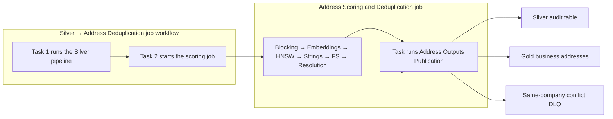

# Address scoring and deduplication

Run **Silver → Address Deduplication** to refresh the existing Silver pipeline and
then start **Address Scoring and Deduplication** after Silver succeeds. The child
workflow can also run independently against the committed Silver inputs.

The child workflow runs blocking, embeddings, HNSW retrieval, string comparisons,
unified Fellegi–Sunter scoring, resolution, and **Address Outputs Publication**.
Each task receives the exact upstream run ID. Successful publication
reads a completed resolution snapshot from `addressresolution.matching`.

The Jobs task graph contains the execution dependencies. The Silver pipeline's
chart shows its datasets. The publication pipeline's chart shows the two output
tables and their data dependencies. Python transformations do not launch jobs.
The scoring workflow executes the experiment notebooks directly as tasks.



## Business outputs

| Table | Meaning |
| --- | --- |
| `addressresolution.silver.addresses_deduplication` | Every source observation, its resolution status, group and source lineage, and match evidence |
| `addressresolution.gold.addresses_deduplicated` | Business address fields, including country, the retained provider key, and timestamps. Entities on hold are left out |
| `addressresolution.silver.dlq_same_company_conflict` | Every source record of an entity held back from Gold because another record names the same company at an address the matcher would not merge with it |
| `addressresolution.silver.dlq_incomplete_v2` | The open incomplete queue: `dlq_incomplete` minus the rows completed from a Gold record |
| `addressresolution.silver.address_pipeline_accounting` | One row of counts for the latest run: source rows, rows parked as incomplete or in translation review, rows into deduplication, Gold rows, folded duplicates, and rows flagged for match review. The update fails unless every source row is accounted for |

Gold declares `(provider, provider_id)` as its Unity Catalog primary key. The
resolver checks that these keys are present and unique among the retained rows.
In Silver, `entity_id` identifies the resolved group, `provider_count` counts its
distinct providers, and `source_records` lists its source keys. Rejected
observations have no resolved group.
`country_inferred` stays in Silver to trace the provenance of `country`.

`is_duplicate` identifies rows suppressed from Gold. `canonical_record_id` links
each duplicate to the retained source. `deduplication_steps` identifies exact,
blocked fuzzy, HNSW fuzzy, or cluster-completion matching. `merge_authority`
states what authorized the group (see [What authorizes a merge](#what-authorizes-a-merge)).
`deduplication_reasons` supplies readable
explanations. `deduplication_evidence` contains direct pair scores, field
similarities, evidence weights, retrieval scores, and geography correction
provenance. Original record and translation evidence are retained in Silver.
The scoring and snapshot run IDs trace each decision back to immutable inputs.

`needs_match_review` is a statement about a pair, not about the record. It is
set on both records of any candidate pair whose Fellegi-Sunter probability is
above 0.80 but which a safeguard refused to merge (a company name below 0.85
Jaro-Winkler, a house or unit disagreement, a region conflict, or an unusual
parse). The record itself is complete, so it stays in Gold as its own entity;
the flag and `match_review_evidence` name the neighbour a reviewer should
compare it with. Most flagged pairs share an address but not a company name:
companies legitimately share buildings, and the pipeline never merges on
address alone.

## Same company, unsettled address

A review pair is different when both records carry the same company name key
(`name_key`, the name with legal forms removed). The matcher refused the merge
because street, city, region or unit disagree, or a parse could not be
verified. That is either one company at two addresses, where one true address
still has to be chosen, or two companies that share a name. Nothing in the
data says which, so publishing both to Gold would assert two addresses the
pipeline has not settled.

`addresses_deduplication` therefore sets `gold_hold_reason =
'same_company_address_conflict'` on every record of both entities and lists
the other side in `same_company_conflicts` (provider key, address, decision,
probability, reason codes, and `differing_fields`). Gold publishes only
canonical records without a hold. `dlq_same_company_conflict` is the queue of
held records: `dlq_reasons` names the parts that differ, and rows with an
empty conflict list are other members of a held entity. Shared-building pairs
(same address, different company) are not held. Deciding the held pairs, by a
rule or by review, is open work; nothing reads this queue back yet.

`address_pipeline_accounting` extends `dlq_routing_audit` through
deduplication. It is the one place to read how many source rows reached Gold,
were folded into another Gold row, are held in `dlq_same_company_conflict`,
wait for match review, or are parked in `dlq_incomplete` because city or
street is blank. Its expectations fail the
update if the counts stop reconciling.

## Incomplete rows completed from a Gold record

Rows in `dlq_incomplete` are never scored: without a city there is nothing to
block on, and without a street there is no location to compare. After
resolution, `attach_incomplete` (`lib/resolution.py`) folds in the ones a
resolved record can complete. A row qualifies only when:

- its single `dlq_reasons` entry is a blank city or a blank street address;
- its `(provider, provider_id)` is unique and not already resolved;
- exactly one resolved entity has the same company name key and country and
  the address part the row still has: the full street key (house, road and
  unit) for a blank city, the city key for a blank street;
- the regions do not conflict.

The blank field is copied from that entity's canonical record, and the row
joins the entity as a duplicate (`deduplication_steps` =
`incomplete_filled_from_resolved`, `filled_field`, `filled_from_record_id`,
`input_route` = `incomplete_filled`; the original row is in
`source_record_json`). It can never become or change the Gold record; it only
adds its provider key to `source_records`. A street fill assumes the company
has one location in that city, which holds when exactly one resolved entity
matches. Every other incomplete row stays parked.

`silver.dlq_incomplete` is the Silver routing stage: it runs before resolution
and is the input to this step, so it keeps every incomplete row. The
publication pipeline then cleans the queue up:
`silver.dlq_incomplete_v2` is `dlq_incomplete` minus the completed
rows, and is the open queue to work from. `address_pipeline_accounting`
fails the update unless `incomplete_rows = incomplete_filled_rows +
incomplete_parked_rows`.

The catalog view
`addressresolution.matching_experiments_aes10130.dlq_hnsw_match_review_queue` reads
the latest completed scoring run in `addressresolution.matching`. It selects
HNSW-only pairs with FS score strictly above 0.80 and a conflict/uncertain decision.

Clear house or suite disagreements between comparable parsed components receive
`non_match_address_conflict`. Silver's `address_non_match_reasons` counts these
pair decisions by reason for each source record. Pair details remain in
`addressresolution.matching.unified_pair_scores`.

Uncertain number parses remain reviewable. An isolated missing or extra digit
also remains reviewable when the FS score is at least 0.99, company and street
similarities are at least 0.95, city and country agree, and the other parsed
address components agree. This exception records a possible typo for inspection.

Inspect a removed address and its retained counterpart with this query.

```sql
SELECT s.provider, s.provider_id, s.company, s.street_address,
       g.company AS canonical_company, g.street_address AS canonical_street_address,
       s.deduplication_steps, s.deduplication_reasons, s.deduplication_evidence,
       s.scoring_run_id
FROM addressresolution.silver.addresses_deduplication AS s
JOIN addressresolution.silver.addresses_deduplication AS c
  ON s.canonical_record_id = c.record_id
JOIN addressresolution.gold.addresses_deduplicated AS g
  ON c.provider = g.provider AND c.provider_id = g.provider_id
WHERE s.is_duplicate
ORDER BY s.record_id;
```

## What authorizes a merge

Three kinds of decision exist, and the tables name them explicitly so a merge
is never mistaken for a review-only suggestion or for a human judgment.

| Level | Where it is recorded | Meaning |
| --- | --- | --- |
| Model proposal | `unified_pair_scores.fs_decision` = `proposed_match`, `fs_merge_authority` = `model_proposal` | The scorer's suggestion: probability at least 0.99, all three similarities at least 0.85, safeguards passed; or `fs_original_text_agreement`, where the text before translation agrees on the fields the translated text disagrees on (see [UNIFIED_SCORING.md](UNIFIED_SCORING.md)). A suggestion, not a merge. |
| Policy-approved merge | `addresses_deduplication.merge_authority` = `exact_rule` or `model_proposal_policy` | The resolver's fixed policy accepted the evidence: every exact pair, and every model proposal that re-passes the probability, similarity, and safeguard checks with consistent cross-group evidence. **This is what merges records today; it is automatic.** |
| Human decision | `unified_pair_scores.fs_human_decision`; `merge_authority` = `human_review` | Reserved. Scoring always leaves `fs_human_decision` NULL and the resolver never emits `human_review`. `match_labels` stores reviewer labels but nothing reads them into resolution yet. |

`merge_authority` is `incomplete_fill_policy` when the only records folded
into a group are completed incomplete rows, and `none` for singletons. A record whose group needed at least
one model proposal is `model_proposal_policy` even if some of its direct proofs
were exact. Pair-level detail stays in `deduplication_evidence`.

## Resolution policy

The entity is the same company at the same location. Exact groups require company
and every address field to agree after the existing case/whitespace normalization.
Fuzzy links require FS probability at least 0.99, company/street/city JW
similarities at least 0.85, and passing address/geography/model safeguards.
An original-text link (step `original_text_agreement`) instead requires each
of company, street and city to agree before translation or meet 0.85, the
company to agree before translation or meet 0.95, at least one field agreeing
before translation, and the same safeguards; the resolver re-checks this from
the pair's own `original_*_agreement` flags rather than trusting the scorer.

Group merging requires passing evidence for every cross-group pair. Unverified
transitive paths remain separate and carry cluster-consistency review evidence.
Every suppressed record has direct evidence against its canonical record.

Before resolution, connected groups of passing exact/fuzzy pairs receive a bounded
completion pass. Missing pairs within groups of at most 100 records are scored
with the saved fitted model and the full original population (including its term
frequencies). At most 100,000 pairs are added, within the existing 2,000,000 total
pair limit. A group that exceeds either budget is skipped whole, recorded in
`resolution_completion_audit`, and retains conservative cluster review behavior.
Existing negative/review pairs are never treated as missing. Newly scored pairs
must pass the same string, address, geography, and model checks; connectivity
alone never permits a merge. Geography donor consensus is recomputed over the
combined pair set. Historical unified scores remain untouched; the evidence
actually used by resolution is in `resolution_pair_scores`, keyed by
`deduplication_run_id`. Completion proofs use `fellegi_sunter_cluster_completion`.

Canonical selection uses support for the original complete record variant, then
prefers supplied country metadata, then stable source identity. All fields come
from one selected observation. Unresolved potential matches are retained as
separate address records. Their review flags and evidence are exposed in Silver.
Gold contains business records and source metadata. Fuzzy model probabilities
remain uncalibrated.

Input rejections remain visible in Silver with their rejection reasons and are
excluded from Gold. Before marking a resolution complete, the workflow verifies
input conservation, unique source identities, one canonical per entity,
canonical-reference integrity, and direct evidence for every duplicate.

## Execution and recovery

The workflow is serverless STANDARD batch compute. It retains the experiment's
explicit capacity limits of 50,000 input records and 2,000,000
candidate pairs. Exceeding a limit fails the run rather than truncating data.
Only completed resolution snapshots can publish. A failed refresh leaves the
previous completed snapshot available.

Use Jobs **Repair run** for unsuccessful tasks and their dependents. Each task
attempt writes a fresh ID incorporating its execution count; downstream tasks
receive the successful upstream ID through task values. HNSW search has its own
attempt ID and reuses the successful embedding snapshot. A resolution failure
therefore does not repeat translation, embedding, retrieval, or model fitting.
Partial artifacts remain isolated and are never published; completed artifacts
are not overwritten. Direct notebook/standalone experiment runs still require a
fresh explicit output ID after failure. Publication-only repair reuses the last
completed resolution snapshot.
The parent and child workflows each allow one concurrent run and queue subsequent
runs. The pipeline publishes Silver before its dependent Gold materialized view.

Deploy from this directory with `databricks bundle deploy -t dev --profile
aes10130@nyu.edu`. Start the full refresh workflow with `databricks bundle run
silver_to_address_deduplication -t dev --profile aes10130@nyu.edu`.
