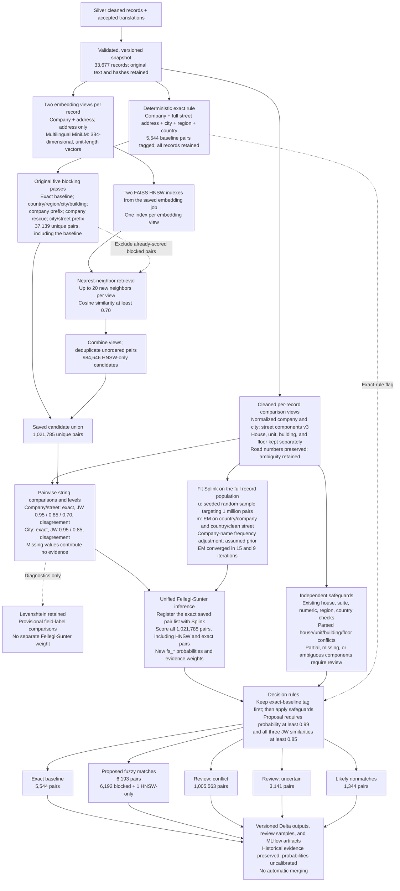

# Address matching pipeline

Current unified scoring run:
[525733446208790](https://dbc-031efa75-388b.cloud.databricks.com/jobs/632401166051077/runs/525733446208790?o=7474651042679944).
The saved candidate generators and embeddings are reused. Counts below are pairs
unless explicitly labeled records. Exact-baseline pairs are included in blocking
and the final union; they are not added again as a separate candidate source.

The full model, guard rules, before/after counts, validation, and query are in
[UNIFIED_SCORING.md](UNIFIED_SCORING.md). The 384-dimensional embedding vectors
remain intact; cosine is a retrieval similarity, and the Fellegi–Sunter score
comes from the learned string-comparison evidence. The 150 model-reviewed field
judgments are diagnostic only and were not used as entity-match training labels.
